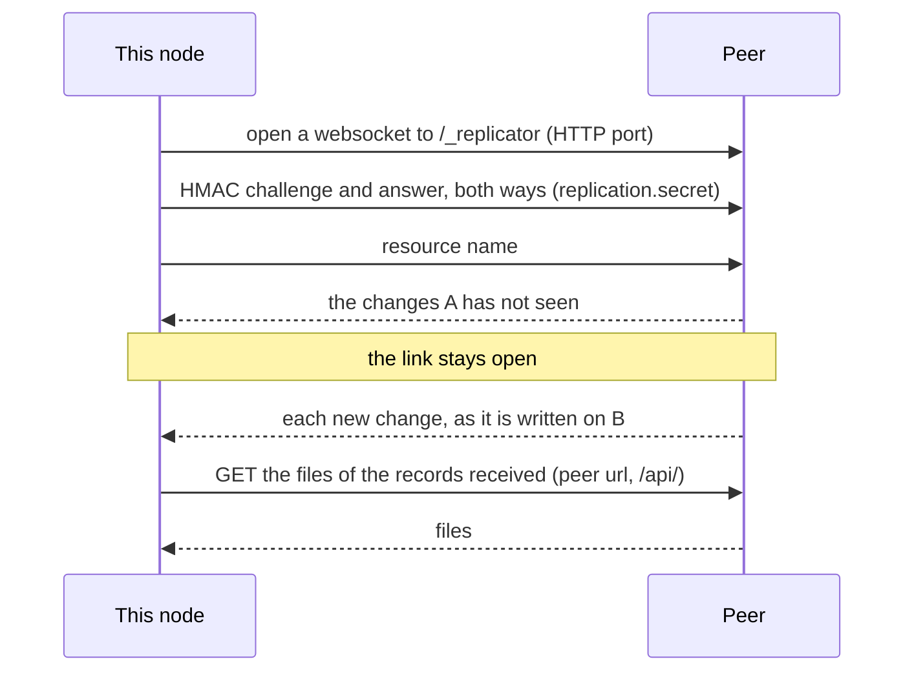
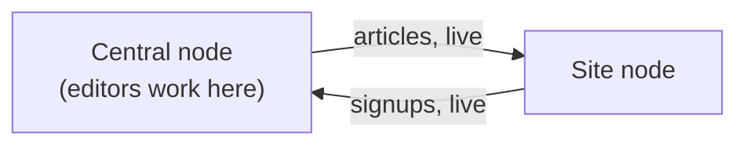
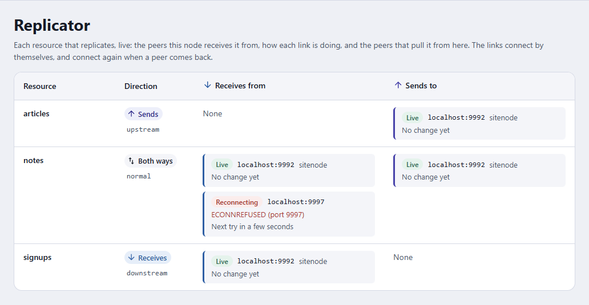

← [Documentation](../README.md)

# Replication

Replication keeps the records and files of a resource identical on several embed-cms servers. The usual reason is a fleet: one server where editors work, and several sites, kiosks or edge servers that should show the same content, or that collect data (logs, sign-ups) and send it back.

It works at the level of the store, record by record, and it knows which node created each record. If all you need is to copy a few resources between a staging and a production CMS now and then, the simpler [sync plugin](SYNC.md) is probably a better fit.

## How it works

Every record id carries the [`mid`](../reference/CONFIG.md#core) of the node that created it. A node only edits its own records; the others it receives from peers are read-only (`_local: false`). This is what keeps two nodes from overwriting each other, and why every node needs its own 8-character `mid`.

Replication is live. A node keeps a link open to each peer it receives a resource from, and the link pulls:

1. **Records.** The node opens a websocket to the peer, on the HTTP port at `/_replicator` next to the REST API, and names the resource. The peer sends the changes the node hasn't seen yet, then each new change as it is written. The link stays open.
2. **Files.** Half a second after records arrive, the node compares their attachments with what it has (by MD5), downloads the missing or changed files from the peer's REST API, and removes those that are gone.



A link that drops connects again by itself, after 1, 2, 5, 10, then 30 seconds while it keeps failing, and takes what it missed. The peer pings every 15 seconds; a node that hears nothing from a peer for 45 seconds drops the link and connects again.

A store on MongoDB or PostgreSQL can't keep a link open: it sends what it has and ends. A node pulling from such a peer asks again every `replication.pollInterval` (30 seconds by default).

The node a peer connects to only sends. Nothing a connecting peer sends is stored, so a node changes only through the links it opened itself, to the peers it lists.

## Setting it up

The replication plugin is **on by default** (`disableReplication: false`), and with no peers it has nothing to do. Two settings make it useful:

- `replication.secret`: the same long random string on every node. A node listens for peers only when it is set, and opens no link without it.
- `replication.peers` (or `replication.peersByResource`): the nodes this one receives from, each by the url of its REST API.

Replication needs no port of its own: a peer connects to the HTTP port of the CMS, the one its REST API answers on.

```json
{
  "mid": "site0001",
  "replication": {
    "secret": "the-same-long-random-string-on-every-node",
    "peersByResource": {
      "articles": [
        { "url": "http://central.internal:9990/api/", "direction": "upstream" }
      ]
    },
    "auth": { "username": "replicator", "password": "…" }
  }
}
```

| Option | What it does |
|---|---|
| `replication.peers` | The peers of every resource of yours. The resources of the CMS itself (`_users`, `_groups`, `_settings`...) are never in it: they need `peersByResource`. Each peer is `{ url, direction }`: `url` is its REST API, ending in `/api/`. The records come from the websocket next to it (`http://site/cms/api/` gives `ws://site/cms/_replicator`, and `https` gives `wss`), the files from the API itself. |
| `replication.peersByResource` | Peers per resource name. Replaces `peers` for that resource, and is the only way to replicate a resource of the CMS. |
| `replication.auth` | `{ username, password }` sent as Basic credentials when downloading files from a peer that requires a login. |
| `replication.secret` | A shared secret. Both sides prove they know it (HMAC-SHA256 challenge) before any resource is named. Without it the node doesn't listen (`/_replicator` answers 404) and opens no link. |
| `replication.strictTypes` | Open links only to the peers whose `direction` says this node takes from them ([Directions](#directions)). Off by default. |
| `replication.pollInterval` | Milliseconds between two pulls from a peer whose store can't keep a link open (MongoDB, PostgreSQL). `30000` by default. |
| `replication.maxRecordBytes` | Largest record accepted from a peer with `strictReplication` (4 MB). |

### Moving from 3.x

Earlier versions replicated over a TCP port of their own, `netPort`, and only after a write or when someone asked. Now:

- Remove `netPort`. A node that still has it logs a warning and ignores it.
- Give each peer its `url`, the address of its REST API. `host` and `port` are ignored.
- Set `replication.secret` on every node: without it, a node neither listens nor opens links.
- On each node, list the peers it receives from: a node pulls, and nothing is pushed to a peer that doesn't list this node.
- A proxy or load balancer in front of a node must let websocket upgrades through on `/_replicator`, as it does for `/_updates`.
- `replication.settleDelay` and `POST /replicator/sync/:resource/:id` are gone. Close the old replication port in the firewall.

### Directions

The `type` of a resource says what this node does with it, so it can differ from one node to another:

| `type` | This node pulls it from its peers | Peers can pull it from this node |
|---|---|---|
| `normal` (default) | Yes | Yes |
| `downstream` | Yes | Yes |
| `upstream` | No | Yes |

`downstream` behaves as `normal`. It marks a resource this node only receives, and it is the type of the resources of the CMS. `upstream` marks a resource this node only sends: it never pulls it, even from a peer it lists.

The `direction` of a peer says which way the data goes between it and this node:

| `direction` | The peer is |
|---|---|
| `upstream` | A node this one pulls from |
| `downstream` | A node that pulls from this one: listing it opens no link |
| `normal` | Both |

The directions are checked only with `replication.strictTypes: true`. A node then opens links only to peers marked `upstream` or `normal`; a peer without a `direction` gets no link. Without `strictTypes`, a node opens a link to every peer it lists, for every resource it pulls.

#### A central node and its sites

Editors write articles on the central node, and every site shows them. Visitors sign up on the sites, and the central node collects the signups. Each node pulls what it receives, so the types differ between the two:

| Resource | Type on the central node | Type on a site |
|---|---|---|
| `articles` | `upstream` | `downstream` |
| `signups` | `downstream` | `upstream` |

The site pulls the articles from the central node:

```json
{
  "mid": "site0001",
  "replication": {
    "secret": "the-same-long-random-string-on-every-node",
    "strictTypes": true,
    "peersByResource": {
      "articles": [{ "url": "http://central.internal:9990/api/", "direction": "upstream" }]
    }
  }
}
```

The central node pulls the signups from the site:

```json
{
  "mid": "central1",
  "replication": {
    "secret": "the-same-long-random-string-on-every-node",
    "strictTypes": true,
    "peersByResource": {
      "signups": [{ "url": "http://site-1.internal:9990/api/", "direction": "upstream" }]
    }
  }
}
```



A new site gets every article as soon as its link connects: the first thing a link does is take what the node lacks.

#### Users, groups and settings

`_users`, `_groups`, `_settings`, `_sync` and `_xlsx` are `downstream`, and the global `replication.peers` list never covers them: a node pulls them only from the peers `peersByResource` names for them. Every node creates its own `admins` group and `localAdmin` user the first time it starts, and a node can't edit a record that another node created. When a node pulls `_groups` and `_users` from a node that started on its own, it receives the other node's `admins` group. It can't update that group, can't set up its `localAdmin`, and its admin login stops working. So name them in `peersByResource` only between nodes that don't each hold their own copy of the same records.

## Watching it

When replication runs, the admin has a **Replicator** page in the CMS menu (for the `admins` group, which gets it by default whenever replication runs). There is nothing to start there: it shows, and refreshes every two seconds, each resource that replicates, the peers this node pulls it from with the state of each link (**Live**, **Connecting**, **Reconnecting** with the error and the next try, **Polling** or **Waiting** for a MongoDB or PostgreSQL peer) and the time of the last change it brought, and the peers that pull it from this node.



The same is available over HTTP to any logged-in user (the routes are in `routesToAuth`), and from code:

| Route | What it does |
|---|---|
| `GET /replicator/resources` | Each resource with its type, its peers, its links (`receives`) and the peers pulling from this node (`sends`). |
| `POST /replicator/sync/:resource` | Connects the links of a resource again now, so they catch up at once after a change of configuration or an outage. `404` for a resource this node doesn't have, `500` when it pulls the resource from no peer. |

```js
cms.$replicator.status()
cms.$replicator.syncResource('articles')
```

## What can go wrong

- A link stays **Reconnecting**. Its error says what the peer answered. A `404` means the peer has no `replication.secret`, or `url` isn't its REST API. A refused secret means the two nodes don't share the same `replication.secret`. A proxy in front of the peer must let websocket upgrades through on `/_replicator`.
- A resource has no link. This node doesn't list a peer for it, the resource is `upstream` here, or `strictTypes` is on and no peer is marked `upstream` or `normal`.
- Records arrive, files don't. `url` must be the peer's REST API ending in `/api/`, reachable from this node. If the peer requires a login to read the resource, set `replication.auth`. Look in the log for MD5 mismatches.
- "Can't modify foreign records". The record was created on another node. Edit it there.
- Two nodes clash. They share a `mid`. Give each node its own, before it creates records.

## Security

A peer that knows `replication.secret` can pull every resource this node has. It can't write: the node it connects to only sends, and a node stores only what it pulls through its own links. Set a long secret on every node: it authenticates peers, it doesn't encrypt the traffic. Serve the CMS over HTTPS and give the peers `https://` urls, so the records travel over `wss://`. With `strictReplication` (on by default), a peer may only ask for resources this node has, and each record a node pulls is checked before it is stored. Details in [SECURITY.md](../../SECURITY.md).
