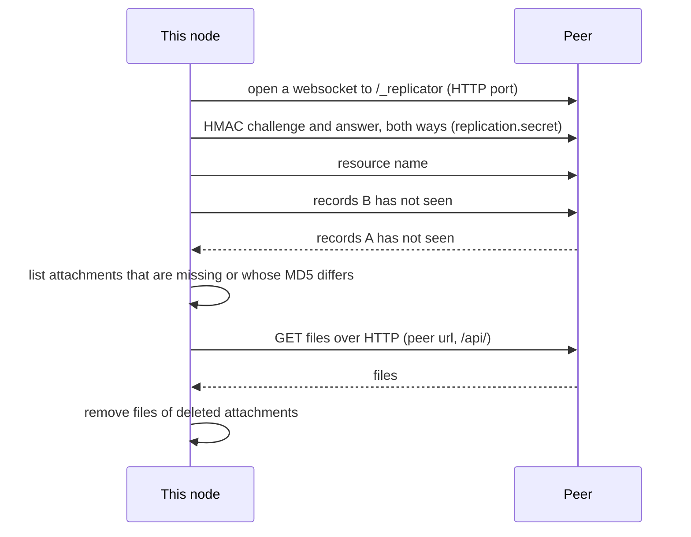
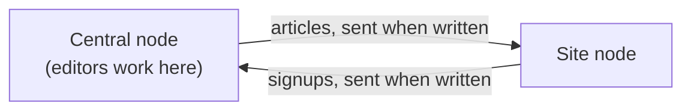

← [Documentation](../README.md)

# Replication

Replication keeps the records and files of a resource identical on several embed-cms servers. The usual reason is a fleet: one server where editors work, and several sites, kiosks or edge servers that should show the same content, or that collect data (logs, sign-ups) and send it back.

It works at the level of the store, record by record, and it knows which node created each record. If all you need is to copy a few resources between a staging and a production CMS now and then, the simpler [sync plugin](SYNC.md) is probably a better fit.

## How it works

Every record id carries the [`mid`](../reference/CONFIG.md#core) of the node that created it. A node only edits its own records; the others it receives from peers are read-only (`_local: false`). This is what keeps two nodes from overwriting each other, and why every node needs its own 8-character `mid`.

A sync between two nodes has two parts:

1. **Records** go over a websocket on the HTTP port, at `/_replicator` next to the REST API. The node that starts the sync connects to the peer and names a resource; both sides then exchange the changes the other hasn't seen yet, using an index of changes per machine.
2. **Files** go over HTTP. Once the records are in, the node compares the attachments of the records it received with what it has (by MD5), downloads the missing or changed ones from the peer's REST API, and removes those that are gone.



A sync starts after each create, update or remove of a record whose resource has a `type` other than `normal` (if that resource has peers), or when you ask for it over HTTP or from code.

## Setting it up

The replication plugin is **on by default** (`disableReplication: false`), and with no peers it has nothing to do. Two settings make it useful:

- `replication.secret`: the same long random string on every node. A node listens for peers only when it is set, and only replicates with a peer that proves it knows it.
- `replication.peers` (or `replication.peersByResource`): the nodes this one syncs with, each by the url of its REST API.

Replication needs no port of its own: a peer connects to the HTTP port of the CMS, the one its REST API answers on.

```json
{
  "mid": "editnode",
  "replication": {
    "secret": "the-same-long-random-string-on-every-node",
    "peersByResource": {
      "articles": [
        { "url": "http://site-1.internal:9990/api/", "direction": "downstream" }
      ]
    },
    "auth": { "username": "replicator", "password": "…" }
  }
}
```

| Option | What it does |
|---|---|
| `replication.peers` | The peers of every resource of yours. The resources of the CMS itself (`_users`, `_groups`, `_settings`...) are never in it: they need `peersByResource`. Each peer is `{ url, direction }`: `url` is its REST API, ending in `/api/`. The records go to the websocket next to it (`http://site/cms/api/` gives `ws://site/cms/_replicator`, and `https` gives `wss`), the files to the API itself. |
| `replication.peersByResource` | Peers per resource name. Replaces `peers` for that resource, and is the only way to replicate a resource of the CMS. |
| `replication.auth` | `{ username, password }` sent as Basic credentials when downloading files from a peer that requires a login. |
| `replication.secret` | A shared secret. Both sides prove they know it (HMAC-SHA256 challenge) before any resource is named. Without it the node doesn't listen (`/_replicator` answers 404) and doesn't replicate. |
| `replication.strictTypes` | Check the `direction` of each peer against the type of the resource ([Directions](#directions)). Off by default. |
| `replication.settleDelay` | Milliseconds to wait for the peer to flush before syncing files (`2000`). |
| `replication.maxRecordBytes` | Largest record accepted from a peer with `strictReplication` (4 MB). |

### Moving from `netPort`

Earlier versions replicated over a TCP port of their own, `netPort`, with `host` and `port` on each peer. Now:

- Remove `netPort`. A node that still has it logs a warning and ignores it.
- Give each peer its `url`, the address of its REST API. `host` and `port` are ignored.
- Set `replication.secret` on every node: without it, a node doesn't listen.
- A proxy or load balancer in front of a node must let websocket upgrades through on `/_replicator`, as it does for `/_updates`.
- Close the old replication port in the firewall: nothing listens on it any more.

### Directions

Each node reads the `type` of a resource from its own declaration, so declare the same type on every node. The type says what the node that starts a sync does:

| `type` | The node that starts the sync | A write starts a sync |
|---|---|---|
| `normal` (default) | Sends its changes and takes the other node's | No: it syncs when you ask |
| `upstream` | Sends its changes, and the other node takes them | Yes |
| `downstream` | Takes the other node's changes, and sends none | Yes |

A write to an `upstream` or `downstream` resource that has peers starts a sync on the node where it was written. With `upstream`, the record leaves at once. With `downstream`, the node fetches from its peers, and its own write waits until a peer starts a sync of that resource.

The `direction` of a peer says which way the peer is from this node:

| `direction` | The peer is |
|---|---|
| `downstream` | A node this one sends to |
| `upstream` | A node this one fetches from |
| `normal` | Both |

The directions are checked only with `replication.strictTypes: true`. An `upstream` resource then goes only to `downstream` peers, and a `downstream` resource comes only from `upstream` peers. A `normal` resource, or a peer marked `normal`, always passes. A peer without a `direction` is used for `normal` resources only. Without `strictTypes`, every peer is used for every resource, and the type still decides which side sends.

#### A central node and its sites

Editors write articles on the central node, and every site shows them. Visitors sign up on the sites, and the central node collects the signups. Each resource is written in one place and sent from there, so both are `upstream`, on every node:

```js
// resources/articles.js and resources/signups.js, the same on every node
module.exports = { type: 'upstream', schema: [ /* … */ ] }
```

The central node sends the articles to the site:

```json
{
  "mid": "central1",
  "replication": {
    "secret": "the-same-long-random-string-on-every-node",
    "strictTypes": true,
    "peersByResource": {
      "articles": [{ "url": "http://site-1.internal:9990/api/", "direction": "downstream" }]
    }
  }
}
```

The site sends the signups to the central node:

```json
{
  "mid": "site0001",
  "replication": {
    "secret": "the-same-long-random-string-on-every-node",
    "strictTypes": true,
    "peersByResource": {
      "signups": [{ "url": "http://central.internal:9990/api/", "direction": "downstream" }]
    }
  }
}
```



A site that missed articles, a new one for example, gets them when the central node starts a sync of `articles`: **Sync all** on its Replicator page, or `POST /replicator/sync/articles`.

#### Users, groups and settings

`_users`, `_groups`, `_settings`, `_sync` and `_xlsx` are `downstream`, and the global `replication.peers` list never covers them: they replicate only when `peersByResource` names them. Every node creates its own `admins` group and `localAdmin` user the first time it starts, and a node can't edit a record that another node created. When two nodes that each started on their own replicate `_groups` and `_users`, the node that fetches receives the other node's `admins` group. It can't update that group, can't set up its `localAdmin`, and its admin login stops working. So name them in `peersByResource` only between nodes that don't each hold their own copy of the same records.

## Starting a sync by hand

When replication runs, the admin has a **Replicator** page in the System menu (for the `admins` group, which gets it by default whenever replication runs). It lists the resources with their type and peers, syncs a resource or one record, and says which peers failed. The same is available over HTTP to any logged-in user (the routes are in `routesToAuth`), and from code:

| Route | What it does |
|---|---|
| `GET /replicator/resources` | Resources with their type and peers. |
| `POST /replicator/sync/:resource` | Sync a resource with its peers. |
| `POST /replicator/sync/:resource/:id` | Bring one record to the peers: `404` if this node doesn't have it. The record travels with any other change of the resource the peer hasn't seen yet (the protocol exchanges changes, so nothing is sent twice); only that record's attachments are synced. |

```js
await cms.$replicator.syncResource('articles')
```

## What can go wrong

- Nothing arrives. The error says what the peer answered. A `404` means the peer has no `replication.secret`, or `url` isn't its REST API. A refused secret means the two nodes don't share the same `replication.secret`. A proxy in front of the peer must let websocket upgrades through on `/_replicator`.
- Records arrive, files don't. `url` must be the peer's REST API ending in `/api/`, reachable from this node. If the peer requires a login to read the resource, set `replication.auth`. Look in the log for MD5 mismatches.
- "Can't modify foreign records". The record was created on another node. Edit it there.
- Two nodes clash. They share a `mid`. Give each node its own, before it creates records.
- `POST /replicator/sync/…` answers 200 but nothing changed. Errors of each peer are collected into the answer instead of failing the request. Read the body (the Replicator page shows them), and the server log.

## Security

The replication websocket can read and write every record of the resources it serves. Set a long `replication.secret` on every node: the secret authenticates peers, it doesn't encrypt the traffic. Serve the CMS over HTTPS and give the peers `https://` urls, so the records travel over `wss://`. With `strictReplication` (on by default), a peer may only ask for resources this node has, and what it sends is validated. Details in [SECURITY.md](../../SECURITY.md).
